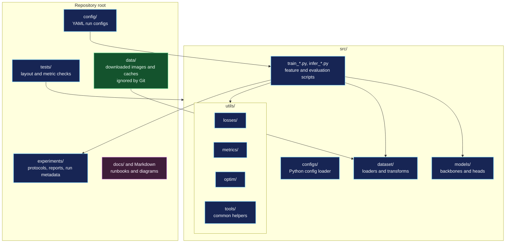
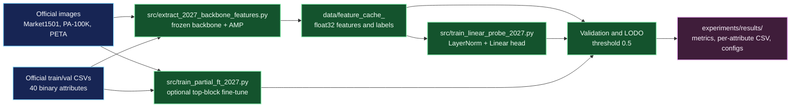

# Repository and experiment architecture

This repository separates source code, runtime data, configuration, tests, and experiment records. Source of the diagrams is in [`repository-architecture.mmd`](repository-architecture.mmd) and [`experiment-flow.mmd`](experiment-flow.mmd).

## Repository layout

`config/` contains user-editable YAML files. `src/configs/` is the Python package that parses them. `src/utils/` contains the moved loss, metric, optimizer, and helper packages. Run Python entry points from the repository root as `python src/<script>.py`; the script directory then supplies the import root for `configs`, `dataset`, `models`, and `utils`.

## Data and training flow

For setup commands and model/data links, see [`RUN_RESEARCH.md`](../RUN_RESEARCH.md). Training protocols and current score limitations are described in [`../experiments/README.md`](../experiments/README.md).
